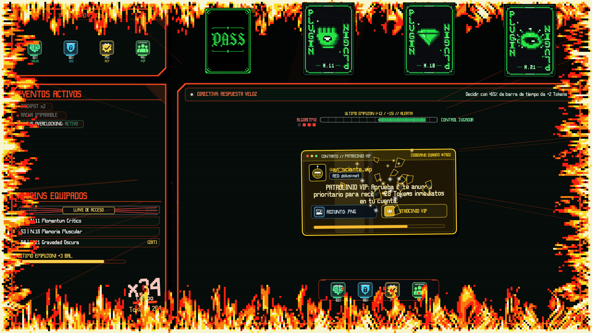
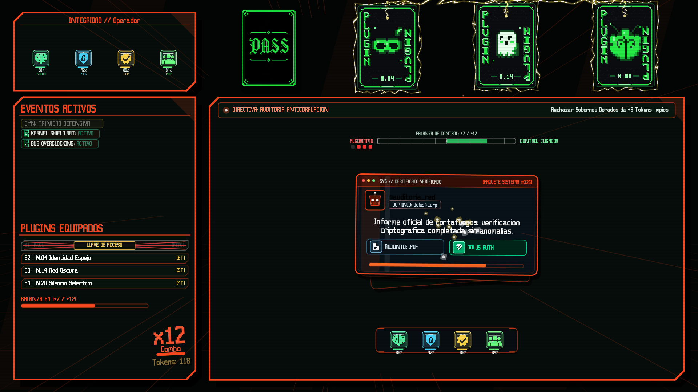
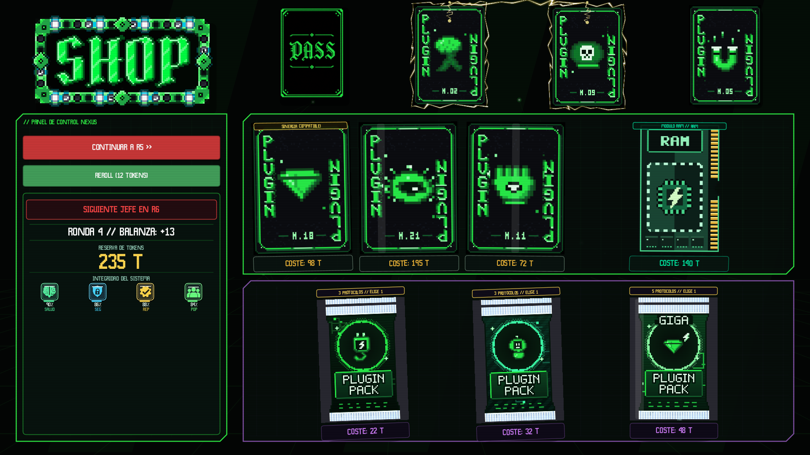
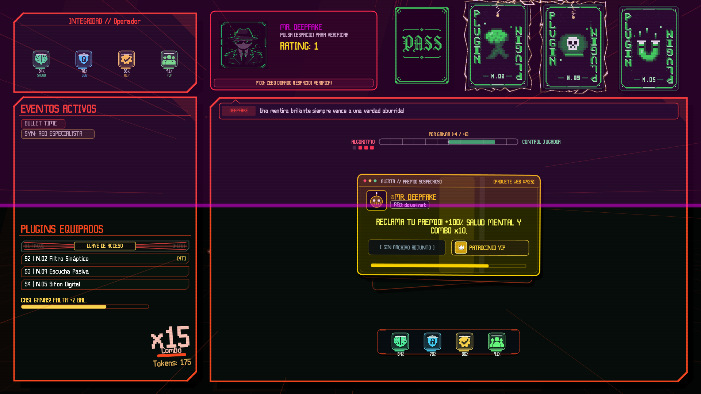
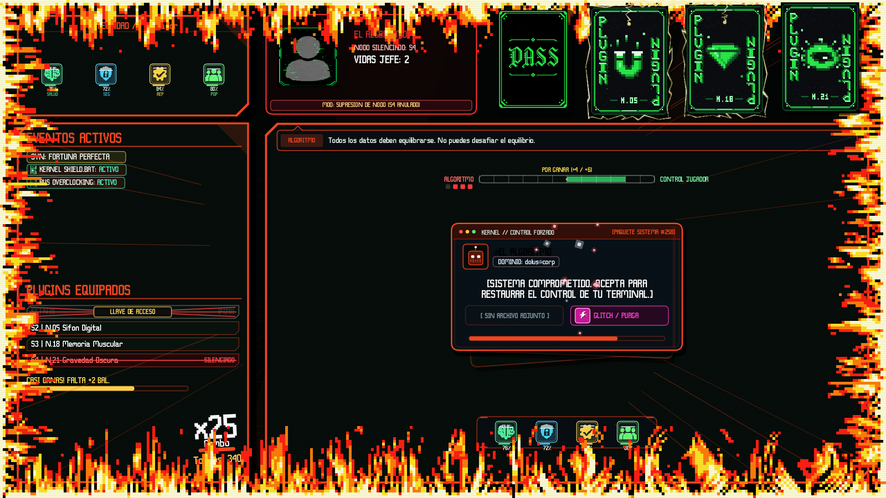

# DOLUS — Digital Balance

Juego de moderación digital y ciberseguridad desarrollado en Processing 4. El jugador administra el flujo de mensajes entrantes entre la red pública (`dolus@net`) y el canal interno (`dolus@corp`), verificando dominios, adjuntos y sellos de autenticidad mientras protege la estabilidad del sistema y adquiere mejoras en la Tienda Nexus.



## Capturas

| | |
| :---: | :---: |
|  |  |
| **Sinergias en tiempo real**: combinación de plugins enlazados con descarga eléctrica y verificación corporativa `DOLUS AUTH`. | **Tienda Nexus**: compra de plugins pasivos y activos, módulos de memoria RAM y paquetes aleatorios entre rondas. |
|  |  |
| **Jefe Mr. Deepfake**: verificación de mensajes manipulados mediante el escáner antes de tomar una decisión. | **Jefe final El Algoritmo**: supresión dinámica de un slot del sistema durante rondas de alta velocidad. |

## Modos de juego

- **Modo Historia**: campaña por rondas con reglas progresivas (`dolus@net` y `dolus@corp`), Tienda Nexus, cuatro combates de jefe, tres ranuras de guardado local y epílogo interactivo.
- **Modo Exposición**: recorrido guiado con tutoriales integrados, rondas breves y enfrentamiento contra los cuatro jefes hasta el epílogo.
- **Modo Feria**: supervivencia infinita con dificultad creciente, registro persistente de jugadores y tabla local de puntajes exportada en JSON y CSV.

## Requisitos y ejecución

1. Instalar [Processing 4](https://processing.org/download).
2. En Processing, abrir `Sketch -> Import Library -> Manage Libraries...` e instalar la librería oficial **Sound** (The Processing Foundation).
3. Clonar este repositorio o descargar el código en ZIP.
4. Abrir `DOLUS/DOLUS.pde` desde Processing y ejecutar con **Run** (`Ctrl + R`).

## Controles

| Acción | Control |
| :--- | :--- |
| Aprobar o rechazar mensaje | Arrastrar carta a la derecha o izquierda |
| Decisión rápida (Modo Feria y Exposición) | Flechas `Derecha` / `Izquierda` |
| Descifrar carta encriptada | Clic rápido repetido sobre la tarjeta |
| Purgar carta contaminada | Mantener clic y sacudir de lado a lado |
| Escáner contra Mr. Deepfake o QTE | Barra espaciadora |
| Pausa | Tecla `Esc` |

## Documentación

- [Manual de Usuario (PDF)](docs/Manual_Usuario_DOLUS.pdf)
- [Manual Técnico (PDF)](docs/Manual_Tecnico_DOLUS.pdf)

## Estructura del proyecto

```text
DOLUS/
├── DOLUS/
│   ├── DOLUS.pde
│   ├── ... (28 módulos .pde del motor y sistemas)
│   ├── sketch.properties
│   └── data/
├── assets/
│   └── screenshots/
├── docs/
│   ├── Manual_Usuario_DOLUS.pdf
│   └── Manual_Tecnico_DOLUS.pdf
├── .gitignore
└── README.md
```

## Equipo

Desarrollado por **Blacklist** en la **Universidad del Norte**:

- Daniel Miranda Gómez
- Luyheer Durán Flórez
- Gabriel Castro López
- Necer Pérez Martínez

Supervisión académica: Rocío del Rosario Ramos Rodríguez.
